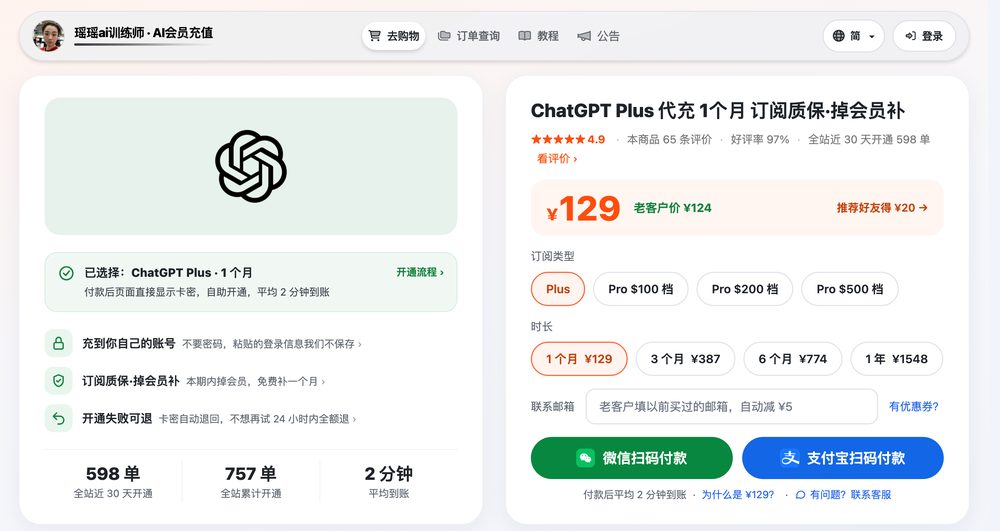
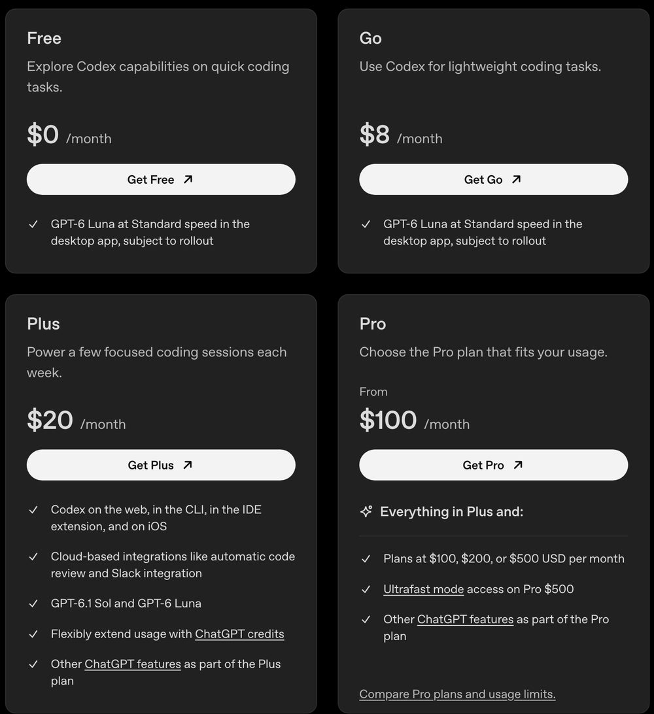

# ChatGPT Go 2026：Go 和 Plus 差在哪、国内能不能开、值不值

> 2026-11-17 更新

**先说结论：** ChatGPT Go 是 OpenAI 每月 8 美元的入门付费档，比免费版多给图片、上传、数据分析的次数，但 GPT-6 Sol、Astra 这些高级推理模型和完整的深度研究都不在里面。国内官网付不了款，瑶瑶ai训练师的商城也不卖 Go；真要付费，更划算的是直接开 Plus：在瑶瑶店里下 [ChatGPT Plus 一个月 ¥129](https://kw.yaoyao.chat/item/5?utm_source=github&utm_medium=readme&utm_campaign=chatgptgo&utm_content=top)，支付宝、微信付，不要密码，平均 2 分钟开好，没开成退钱。下单填券码 **888888** 再减 ¥3。

- **Go 多少钱**：官方每月 8 美元，按月自动扣，没有年付；Plus 是每月 20 美元。
- **Go 缺什么**：没有高级推理模型、站点、开发者模式、结合思考的生图，深度研究和 Codex 只给有限用量，还可能看到广告。
- **国内能不能开**：Go 只在 ChatGPT 支持的国家和地区卖，中国大陆、香港、澳门不在名单；官网只收主要信用卡等海外付款方式。
- **谁不用买**：每天只聊聊天、翻译几段的，免费版文字聊天本来就不限次数；人在支持地区、手里有能付款的卡、确实只要多几次出图和上传的，官网开 Go 也行。

*图：瑶瑶商城的 ChatGPT 商品只有 Plus 和三档 Pro，找不到 Go 是正常的（kw.yaoyao.chat/item/5，11-10 截取）*

## ChatGPT Go 是什么

帮助中心对 Go 的定义只有一句：低价订阅，给更多 ChatGPT 功能的使用权限。它在免费版的基础上加了这些（2026-11-10 核对帮助中心《What is ChatGPT Go?》）：

- 符合条件的工具用量比免费版高；
- 生图次数更多；
- 文件上传、高级数据分析次数更多；
- 记忆更长、上下文窗口更大；
- 能用项目、计划任务、自定义 GPT 和资料库（以功能实际开放情况为准）；
- 能通过"用 ChatGPT 登录"在合作的应用里用 Go 的额度。

同一页也写了它的边界：一些高级产品和更高档的功能要 Plus 或更高档才有；API 不包含，单独计费；在部分地区，Go 用户会被测试广告。

很多人把 Go 当成"便宜版 Plus"，这是最大的误会。它更像"加量版免费"：次数多了，能力档位没怎么变。kw 也有一页 [ChatGPT Go 值得买吗](https://kw.yaoyao.chat/guide/chatgpt-go.html?utm_source=github&utm_medium=readme&utm_campaign=chatgptgo&utm_content=guide)，可以对照着看。

## Go 和 Plus 差在哪：一张表看清

下面这张表从 ChatGPT 中文定价页的套餐比较表里摘出日常用得到的几行，2026-11-10 当天核对，月费取自 Codex 定价页：

| 对比项 | 免费版 | Go | Plus |
|---|---|---|---|
| 官方月费 | 0 | 8 美元 | 20 美元 |
| 日常文字聊天 | 不限次数（防滥用规则内） | 同左 | 同左 |
| GPT-6 Sol、GPT-6 Astra、GPT-6.1 Sol | 没有 | 没有 | 有限使用 |
| GPT-6 Luna | 有 | 有 | 有限使用 |
| 旧版模型 | 没有 | 没有 | 有 |
| 响应速度 | 带宽和可用性受限 | 带宽和可用性受限 | 快 |
| 推理总上下文 | 不定 | 256K | 256K |
| 深度研究 | 有限 | 有限 | 有 |
| ChatGPT 工作 | 桌面端受限 | 桌面端受限 | 桌面、网页、手机 |
| Codex | 有限 | 有限 | 有 |
| 站点、开发者模式、交互式表格 | 没有 | 没有 | 有 |
| 结合思考过程的生图 | 没有 | 没有 | 有 |
| 抢先测试新功能 | 没有 | 没有 | 有 |
| 广告 | 可能有 | 可能有 | 没有 |

看这张表，抓住三条就够：

1. **Go 和 Plus 的上下文一样大**，都是推理 256K、Instant 54K。差距不在"能塞多少字"，在"能用哪个脑子"。
2. **Go 没有 Sol 和 Astra**。帮助中心写 Go 的 Think 用的是 GPT-5.6 Luna，并且明说 Go 不含 GPT-5.6 Sol；定价页的模型表里 Go 勾的是 GPT-6 Luna。两页写法略有出入，以你账号里的模型菜单为准，但结论一样：要做复杂推理、写长代码，Go 给不了。
3. **广告这条很实在**。帮助中心《Ads in ChatGPT》写明，广告只出现在免费版和 Go，Plus 及以上没有；生图过程中也在测试图片广告。

*图：OpenAI 官方 Codex 定价页的个人套餐卡片，Go 8 美元/月、Plus 20 美元/月（来源 learn.chatgpt.com 的 pricing 页，截图日期 11-10）*

更完整的四档对比，可以看 kw 的 [ChatGPT 付费和免费有什么区别](https://kw.yaoyao.chat/guide/chatgpt-fufei-qubie.html?utm_source=github&utm_medium=readme&utm_campaign=chatgptgo&utm_content=guide)，或者 GitHub 上那篇 [ChatGPT Plus购买指南](https://github.com/yaoyao-chat/plus)，后者把 Plus 的 Codex 每 5 小时额度也列了。

## ChatGPT Go 国内能不能开

分两层说。

**地区。** 帮助中心写 Go 已经在所有 ChatGPT 支持的国家和地区上线。OpenAI 的支持地区名单（2026-11-10 核对）里没有中国大陆、香港、澳门，台湾在名单上。人在大陆直接用，本身就不在官方服务范围内。

**付款。** Go 一律按美元计价，少数国家能用本地货币结算。定价页常见问题写的是"可以用任何主要信用卡购买 Go、Plus、Pro 或 Business"，名单里没有支付宝和微信。国内常见的银联借记卡、支付宝都过不了，这一点和 Plus 一样，详细原因见 [没有信用卡怎么开通 ChatGPT 会员](https://kw.yaoyao.chat/guide/wu-xinyongka.html?utm_source=github&utm_medium=readme&utm_campaign=chatgptgo&utm_content=guide)。

**应用商店。** 帮助中心提到 Go 也可以经 Apple 或 Google Play 订阅，账单归商店管。走这条路一样要那个商店认的付款方式，对手里只有支付宝、微信的人来说，门槛不比官网低。

所以对国内用户来说，Go 的处境有点尴尬：它便宜，但买它要跨的门槛和买 Plus 一模一样。既然门槛一样，多数人会直接选能力更完整的那个。

## 值不值：按你的用法对一下

| 你的情况 | 更合适的选择 |
|---|---|
| 一周用几次，问问题、翻译、润色 | 免费版 |
| 每天都用，但主要是聊天，偶尔传图传文件 | 免费版先撑着，撞限额多了再说 |
| 要写代码、做调研、分析长文件 | Plus |
| 介意广告 | Plus |
| 生图量大、要带字的海报 | Plus（有结合思考的生图） |
| 写代码一整天、Plus 天天撞顶 | Pro |

算一笔年账：按官方价，Go 一年 96 美元，Plus 一年 240 美元，差 144 美元。这笔差价换来的是高级推理模型、完整深度研究、全平台的 ChatGPT 工作和 Codex、站点、没有广告。如果你每天拿 ChatGPT 干正事，这些基本都会用到；如果只是聊天，Go 和免费版的区别其实也不大。

Plus 官方价和国内价差多少，kw 有一篇 [ChatGPT Plus 多少钱一个月](https://kw.yaoyao.chat/guide/chatgpt-plus-price.html?utm_source=github&utm_medium=readme&utm_campaign=chatgptgo&utm_content=guide)；三档放一起挑的，看 [GPT会员多少钱、Go/Plus/Pro 怎么开](https://kw.yaoyao.chat/guide/gpt-huiyuan.html?utm_source=github&utm_medium=readme&utm_campaign=chatgptgo&utm_content=guide)。

## 已开 Go 的号，能不能直接充 Plus

这是从 Go 往上走时最容易卡住的地方，分官方和代充两条路说。

**官网自己升。** 帮助中心写的升级入口是：头像 → Upgrade Plan → 选 Plus。反方向也写了：Plus 或 Pro 降到 Go，不退差价，当前套餐用到这一期结束，下一期起按 Go 的价格扣。至于 Go 升 Plus 当期怎么折算，帮助中心没有单独写，以结算页显示为准。如果你是在 App Store 或 Google Play 订的 Go，要在原来那个商店里改，网页上改不了。

**用代充卡密充。** 瑶瑶店里卡密开通的规矩是"账号当前不能有正在生效的同类订阅"，Plus 没到期就提交，会提示"已有订阅"，这次卡密不扣，等到期后再用同一张。Go 账号能不能直接提交 Plus 卡密，店里目前没有公开说法，官方也没写。稳妥的做法是：

1. 先在 Go 的订阅设置里取消续费（网页在设置 → Billing；苹果、安卓到各自商店的订阅里取消）；
2. 等这一期到期、账号变回免费版；
3. 再提交 Plus 卡密，开在同一个号上，聊天记录、记忆、项目都还在。

拿不准自己账号状态的，下单前在企业微信问一句再买。卡密没有使用期限，先买好留着，等 Go 到期再用也不浪费。卡密怎么提交，步骤见 [ChatGPT Plus 卡密怎么用](https://kw.yaoyao.chat/guide/plus-kami.html?utm_source=github&utm_medium=readme&utm_campaign=chatgptgo&utm_content=guide)。

还有一种情况：充完 Plus 却还显示 Go 或免费版。多半是登错了号，或者 App 没刷新。先确认登录的邮箱和充值时是同一个，再退出重登，排查顺序见 [充值成功但会员没显示](https://kw.yaoyao.chat/guide/chatgpt-plus-meixianshi.html?utm_source=github&utm_medium=readme&utm_campaign=chatgptgo&utm_content=guide)。

## 已经订了 Go 的人：账单、取消和退款怎么管

人在海外、已经自己订了 Go 的读者，也常来问几件管账的事。帮助中心《What is ChatGPT Go?》和退款说明里写得比较散，这里按顺序捋一遍（2026-11-10 核对）：

- **看发票。** 网页上订的，进设置 → Billing，在 Invoices 那一栏点 View 看单张，点 View all 翻以前的。在苹果或 Google Play 订的，发票不在 ChatGPT 里，要去那个商店账号的购买记录里找。
- **账单设置不见了。** 网页订的却找不到付款相关的按钮，官方建议换一个浏览器登录同一个号再打开试试。
- **手机上刚订完没显示 Go。** 在 App Store 或 Play 商店订的，升级要过几分钟才同步到 App，等一会儿、把 App 关掉重开。
- **取消。** Go 按月自动续，随时能取消，取消后这一期照样能用到底，只是下一期不再扣。卸载 App 不等于取消。
- **退款。** 原则上不退。扣款 7 天内、这一期基本没用过的，可以在帮助中心右下角的对话窗口里申请酌情退款；欧盟、英国、土耳其居民 14 天内取消可按比例退。完整条件见帮助中心 [How do I request a refund](https://help.openai.com/articles/7232895)。

Go 用着觉得不够、准备换 Plus 的，建议在下一次扣款前就把续费关掉，别等扣了 Go 的钱再折腾。

## 瑶瑶店里开 Plus 的流程

1. 下单 Plus 一个月，支付宝或微信付，付完页面上就是卡密。
2. 到 cz.yaoyao.chat，按页面提示复制一段开通用的登录信息（不是密码，也不要验证码），和卡密一起提交。
3. 平均 2 分钟到账，会员开在你自己的号上。

最常见的失败是登录信息过期：复制完隔太久才交，或者中途在别处退出过登录。开无痕窗口重新登录、复制完立刻提交就好。没开成卡密自动退回，能马上重提；不想再试的，把订单号发到瑶瑶企业微信，24 小时内全额退回你付款的支付宝或微信。开通成功后本期内掉会员，凭订单号和截图再补一个月。

要一次开几个月的，有 [ChatGPT Plus 3 个月 ¥387](https://kw.yaoyao.chat/item/5?d=3&utm_source=github&utm_medium=readme&utm_campaign=chatgptgo&utm_content=mid)，一单三张卡密，每张一个月；全年一次开满是 ¥1,548，在订单页填一次信息。三个月、半年、一年都是 ¥129 乘月数，不打折也不加价。买之前想先过一遍注意事项，看 [瑶瑶商城购买须知](https://kw.yaoyao.chat/guide/goumai-xuzhi.html?utm_source=github&utm_medium=readme&utm_campaign=chatgptgo&utm_content=guide)。

## 常见问题

**问：chatgpt go 多少钱一个月？**
官方 8 美元一个月（Codex 定价页，2026-11-10 核对），按月自动扣，不支持年付，也不能预付几个月。官方说价格可能随早期使用情况调整，以定价页为准。

**问：ChatGPT Go 能用 GPT-6 吗？**
只能用 Luna 这一档的轻量模型。GPT-6 Sol、GPT-6 Astra、GPT-6.1 Sol 在定价页上都标着 Go "否"，要 Plus 起才有。

**问：Go 有没有广告？**
可能有。帮助中心 [Ads in ChatGPT](https://help.openai.com/articles/20001047) 写明广告会出现在免费版和 Go，Plus、Pro、Business、Enterprise、Edu 没有。

**问：Go 能用 Codex 写代码吗？**
能用一点。官方给 Go 的定位是"轻量编程任务"，用量有限；每周几次专注写代码，官方给的定位是 Plus。

**问：瑶瑶店里能开 ChatGPT Go 吗？**
不能，店里只卖 Plus 和 Pro。Go 和 Plus 在国内的付款门槛一样，代充 Go 没多大意义。

**问：从 Plus 降到 Go 会退钱吗？**
不会。帮助中心写的是当前套餐用到这一期结束，到期后切到 Go，按 Go 的价格扣。

**问：Go 和 Plus 是同一个账号吗？**
是。都是开在你自己账号上的套餐，换档不用换号，聊天记录、记忆都保留。从免费版往上升的入口在哪，见 [ChatGPT 免费版怎么升级 Plus](https://kw.yaoyao.chat/guide/chatgpt-shengji-plus.html?utm_source=github&utm_medium=readme&utm_campaign=chatgptgo&utm_content=guide)。

看完觉得 Go 不够用，就到瑶瑶店里下 [ChatGPT Plus ¥129 一个月（不卖 Go，直接上 Plus）](https://kw.yaoyao.chat/item/5?utm_source=github&utm_medium=readme&utm_campaign=chatgptgo&utm_content=end)，结账时填 **888888** 一样减 ¥3；它跟推荐码、老客户减 ¥5 不能同时用。

## 相关教程

- [ChatGPT Plus购买指南](https://github.com/yaoyao-chat/plus)：从 Go 往上走，Plus 每个功能具体给多少
- [GPT Pro和Plus的区别](https://github.com/yaoyao-chat/plusvspro)：额度差几倍、谁该升级
- [Codex订阅价格](https://github.com/yaoyao-chat/codex)：Go 只给轻量 Codex，要认真写代码时各档怎么算
- [ChatGPT Pro价格](https://github.com/yaoyao-chat/gpt-pro)：Plus 不够用时，Pro 三档怎么挑

原文地址：[github.com/yaoyao-chat/chatgptgo](https://github.com/yaoyao-chat/chatgptgo)（CC BY-ND 4.0，转载请保留原文地址、不得改编）

## 核对与来源

商城那边的价格、开通、退款、补会员，一律按 11-10 导出的事实卡写；"已有订阅"提示和卡密不扣的说法照 kw 购买须知页。官方部分都是 2026-11-10 当天打开核对。

- 帮助中心 [What is ChatGPT Go?](https://help.openai.com/en/articles/11989085-what-is-chatgpt-go)：Go 包含的内容；所有 ChatGPT 支持地区可买；美元计价、部分国家本地货币；按月自动扣、可随时取消；没有年付；Think 用 GPT-5.6 Luna、不含 GPT-5.6 Sol；不含旧版模型；Plus/Pro 降 Go 不退款、用到期末；部分地区测试广告；API 另计
- [Codex 定价页](https://learn.chatgpt.com/docs/pricing)：Go 每月 8 美元、Plus 每月 20 美元；Go 定位轻量编程
- [ChatGPT 中文定价页](https://chatgpt.com/zh-Hans-CN/pricing/)：免费版、Go、Plus、Pro 套餐比较表（模型、上下文、深度研究、工作模式、站点、生图、广告）；付款用主要信用卡；Go、Plus 只有月度套餐
- 帮助中心 [What is ChatGPT Plus?](https://help.openai.com/en/articles/6950777-what-is-chatgpt-plus)：Plus 每月 20 美元；升级入口在头像 → Upgrade Plan
- 帮助中心 [Ads in ChatGPT](https://help.openai.com/en/articles/20001047)：广告只出现在免费版和 Go
- [OpenAI 支持的国家和地区](https://developers.openai.com/api/docs/supported-countries)：名单里没有中国大陆、香港、澳门

## 关于作者与声明

写这篇的是瑶瑶ai训练师。瑶瑶从 2023 年 10 月开始做 AI 科普，2026 年 3 月开了 kw.yaoyao.chat 这家商城，文中指向商城的链接都是自家广告。这家店做的是代充，不是官方渠道，和 OpenAI 之间没有隶属或授权关系。不管对方怎么自称，账号密码和验证码都不要给；瑶瑶的客服只认企业微信 `kw.yaoyao.chat/wecom`。
